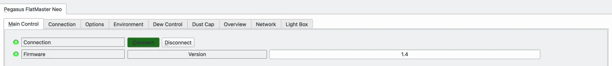
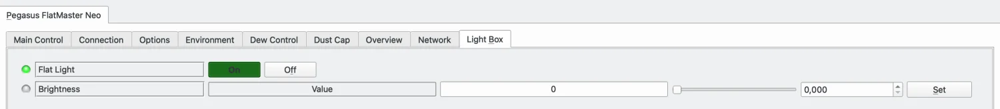
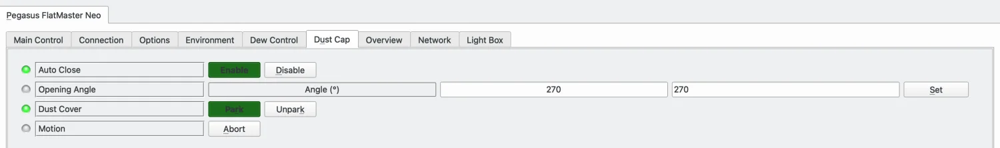
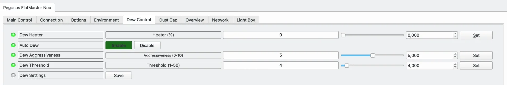
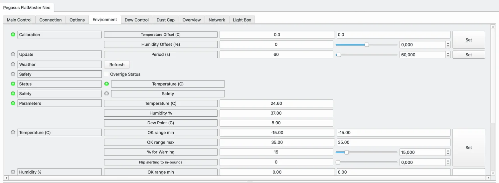
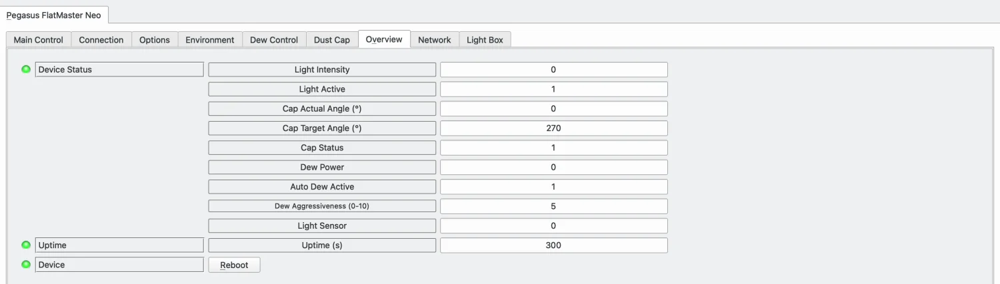
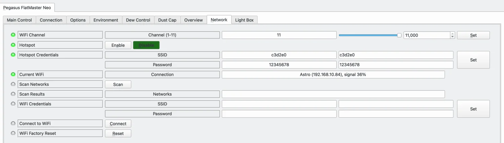

# Pegasus FlatMaster Neo — INDI Auxiliary Driver

This driver supports the Pegasus Astro FlatMaster Neo flat field panel, dust cap control, dew management, environmental sensors, and network/hotspot features via INDI.

## Overview

Implemented INDI interfaces:

- `AUX_INTERFACE`
- `LIGHTBOX_INTERFACE`
- `DUSTCAP_INTERFACE`
- `WEATHER_INTERFACE`

The FlatMaster Neo communicates over USB serial. The driver exposes lightbox on/off and dimming, cap open/close and angle control, dew heater and auto dew, temperature/humidity/dew point monitoring, and WiFi/hotspot management. It was tested with firmware 1.4.

## Supported Hardware

- Pegasus Astro FlatMaster Neo

## Driver Metadata

- Driver Name: `Pegasus FlatMaster Neo`
- Executable: `indi_pegasus_flatmaster_neo`
- Family: Lightbox, Dustcap
- Manufacturer: Pegasus Astro
- Platforms: Linux, BSD, macOS
- Version: 1.3

## Installing & Running

The driver is included in the INDI core package.

Run it manually using:

```bash
indiserver -v indi_pegasus_flatmaster_neo
```

If you build only this driver from the INDI source tree, the build target is also `indi_pegasus_flatmaster_neo`.

## Connectivity

### USB Serial

The FlatMaster Neo uses a USB serial connection. The driver prefers serial ports whose system name contains `FlatMaster`.

- Default baud rate: `9600`
- Supported connection: USB serial

### First Time Connection

1. Power on the FlatMaster Neo.
2. Start the driver from an INDI client or manually with `indiserver -v indi_pegasus_flatmaster_neo`.
3. Select the serial port of the FlatMaster Neo, or let the driver search for it.
4. Click Connect.

The driver handshakes with the device using `F#` and expects a response containing `FMNEO`.

> [!NOTE]
> The automatic port search sends `F#` to every serial port it tries, including other devices such as mounts. Select the port of the FlatMaster Neo directly if several devices are connected.

### Settings stored in the device

The FlatMaster Neo stores its dew, cap, offset and WiFi settings itself. The driver reads them from the device on connection and does not keep them in the INDI configuration, so changes made in Pegasus Unity are not overwritten. Configurations saved by driver versions up to 1.2 still contain these values; they are ignored when the configuration is loaded.

## Features

- Lightbox on/off and brightness control (0–100)
- Dust cap open/close, halt, and target angle control (0–270°)
- Dew heater power control (0–100%)
- Auto dew enable/disable
- Dew aggressiveness level (0–10)
- Dew threshold adjustment (1–50)
- Auto-close cap control
- Temperature, humidity, and dew point from the built-in sensor
- Temperature and humidity calibration offsets
- Device status overview, including light intensity, cap state, dew state, and light sensor readings
- Firmware version and uptime reporting
- Remote device reboot
- Hotspot on/off, credentials and channel
- WiFi network scan and connection, current connection with IP address
- WiFi factory reset

## Driver Controls

### Main Control

The driver exposes a read-only `Firmware` property showing the reported firmware version.



### Light Box

The `Light Box` tab includes:

- `On/Off`
- `Brightness`

Control commands:

- `FE:0` — disable lightbox
- `FE:1` — enable lightbox
- `FL:<value>` — set brightness (0–100). Brightness 0 also switches the panel off.



### Dust Cap

The `Dust Cap` tab includes:

- `Open` / `Close`
- `Abort`
- `Angle`
- `Auto Close`

Control commands:

- `FS:1` / `FS:0` — open / close the cap
- `FH` — halt the cap
- `CD:<angle>` — set target opening angle
- `DC:0` / `DC:1` — auto close off / on

The cap reports its state in the status: 1 closed, 2 moving, 3 open, and 4 after it was halted on the way. A full move to 270° takes about 6 seconds; the driver reports the move as busy until the cap has reached its end position.



### Dew Control

The `Dew Control` tab includes:

- `Dew Heater` percentage
- `Auto Dew` enable/disable
- `Dew Aggressiveness` level (0–10)
- `Dew Threshold` (1–50)
- `Save Dew Settings`

Control commands:

- `DH:<value>` — set heater power
- `PD:0` / `PD:1` — disable/enable auto dew
- `DA:<level>` — set dew aggressiveness. The device applies it right away; the driver does not send the `PD:<9..255>` value that Pegasus Unity uses, because firmware 1.4 treats it as "auto dew on".
- `DT:<value>` — set dew threshold
- `DSTR` — save dew settings. Firmware 1.4 does not know this command (it answers `>>`), and the driver reports that.



### Environment

The `Environment` tab includes:

- `Temperature`
- `Humidity`
- `Dew Point`
- `Temperature Offset`
- `Humidity Offset`

The values come from the sensor built into the FlatMaster Neo. The driver queries them with `ES` and reads/writes offsets with:

- `CR` — read calibration offsets
- `CT:<value>` — set temperature offset
- `CH:<value>` — set humidity offset, a whole number from −50 to 50



### Device Status

The `Overview` tab shows:

- Light intensity
- Light active state
- Cap target angle
- Cap actual angle
- Cap status
- Dew power
- Auto dew active state
- Dew aggressiveness
- Light sensor
- Uptime
- `Reboot`

`Reboot` (`FQ`) restarts the device. Its USB port goes away for a moment, so the driver disconnects; connect again after a few seconds.



### Network

The `Network` tab includes WiFi and hotspot controls:

- `AC` / `AC:<channel>` — read/write the hotspot channel (1–11)
- `A?` / `AE:0` / `AE:1` — hotspot status and enable/disable
- `AL` / `AN:<ssid>` / `AP:<password>` — hotspot credentials (SSID up to 32, password 8–63 characters)
- `WI` — current WiFi connection, shown as SSID, IP address and signal strength
- `WS` — WiFi network scan, listing each network once with its best signal
- `WN:<ssid>` / `WP:<password>` — connect to a 2.4 GHz WiFi network
- `WZ` — WiFi factory reset: clears the WiFi connection and switches the hotspot on again

The scan needs the WiFi radio, which is on while the hotspot is enabled or the device is connected to a network. Passwords are not written to the driver log.

> [!CAUTION]
> The hotspot is on by default and uses the factory password `12345678`. Switch it off, or change its password, if you do not use it.



## Operation

- Connect the FlatMaster Neo via USB and start the driver.
- Use `Light Box` to control panel power and brightness.
- Use `Dust Cap` to open, close, or halt the cap and to set its angle.
- Use `Dew Control` to manage heater power, auto dew, aggressiveness, and threshold.
- Monitor temperature, humidity, and dew point in `Environment`.
- Apply calibration offsets when sensor readings differ from a reference.
- Use `Network` for WiFi and hotspot management.
- Use `Overview` to verify device state, uptime, and reboot when needed.

## Troubleshooting

- If the driver cannot connect, verify the FlatMaster Neo is powered and visible as a serial device.
- Ensure no other application is using the same serial port.
- Confirm the handshake returns `FMNEO`; otherwise the connected device may not be supported.
- If values do not update, reconnect and ensure the device responds to `FA`, `ES`, and `CR`.
- If the WiFi scan finds no networks, enable the hotspot or connect to a network first, then scan again.
- For network issues, check SSID, password, and that the network uses 2.4 GHz.
