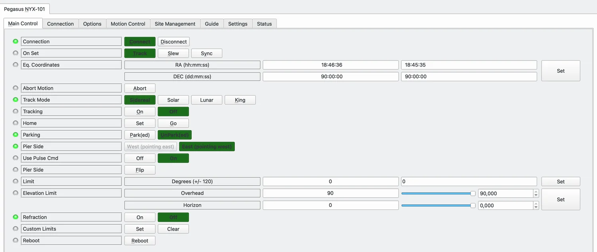
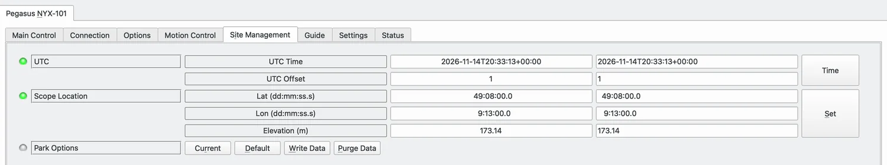
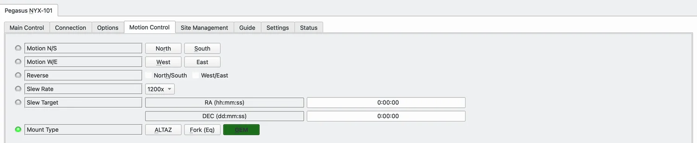
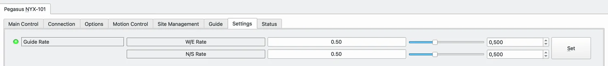
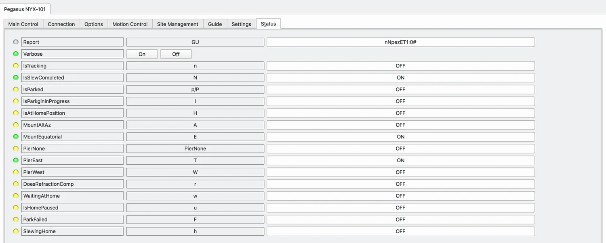

The Pegasus Astro **NYX-101** is a harmonic drive mount that can run in equatorial (GEM) or alt-azimuth mode. The INDI driver uses the LX200-based command set of the mount. The **NYX-88** uses the same driver and is listed under its own name in the driver list.

## Features

- GoTo, Sync, Abort, manual motion
- Park and unpark, setting the park position of the mount
- Go home and set home
- Tracking on/off with sidereal, lunar, solar and King rate
- Pulse guiding with guide rates 0.25×, 0.5× and 1× sidereal
- Pier side readout and manual pier flip
- Equatorial (GEM) or alt-azimuth mount type
- Elevation limits, meridian limit and custom safety limits
- Refraction correction on/off
- Time and location are sent to the mount
- Reboot of the mount controller
- Status tab with the raw mount status for diagnosis

## Installation

The driver is part of INDI core and needs no extra dependencies. To run it on its own:

```shell
indiserver -v indi_lx200_pegasus_nyx101
```

## Connection

Connect the mount by USB and select its port on the **Connection** tab. The default baud rate is 115200.

The driver does not manage the WiFi of the mount.

> [!CAUTION]
> The NYX-101 starts a WiFi hotspot by default, with the factory password `12345678`. Change the password or switch the hotspot off in the Pegasus Unity app if you do not use it.

### After power-on

The mount has no running clock. After power-on it starts with the date and time it last stored, and it keeps the site coordinates. Until it receives the current time, the mount **ignores motion and park commands without reporting an error**. Switching tracking on releases the RA brake, but tracking does not start.

Ekos and KStars send the time and the location when they connect to the mount, so no action is needed with them. When you run the driver from another client, or only with `indiserver`, set `TIME_UTC` before the first move, and `GEOGRAPHIC_COORD` if the site has changed.

The **Report** field on the **Status** tab shows the state. With firmware 1.39.2 the report ends in `9` until the mount has the time, for example `nNpHzEo1:9#`, and in `0` afterwards.

## Driver Controls

### Main Control

- **Park:** the mount moves to the park position stored in the mount, switches the motors off and engages the RA brake. While it moves, the status reports parking. If the mount does not start parking within 10 seconds, the driver reports an error: the mount has no time yet, or no park position.
- **Unpark:** after an unpark request the driver waits up to 10 seconds for the mount to report that it is unparked before it accepts a parked status again. An unpark done with the hand controller or the Pegasus app is detected as well.
- **Home:** go to the home position, or set the current position as home.
- **Pier Side:** **Flip** asks the mount to move to the other side of the pier. The current side is shown in the pier side property of the mount. At the home position the mount reports no pier side.
- **Elevation Limit:** lowest (**Horizon**, −30° to 0°) and highest (**Overhead**, 60° to 90°) altitude limit of the mount.
- **Meridian Limit:** meridian limit of the mount in degrees (±120).
- **Custom Limits:** **Set** stores a custom safety limit in the mount, **Clear** removes it.
- **Refraction:** switch the refraction correction of the mount on or off.
- **Reboot:** restart the mount controller.



### Site Management

- **Park Options:** **Current** stores the current position as the park position of the mount. Move the mount to the park position first; it has to be unparked and stopped, and needs time and location. The mount keeps the park position after power-off. **Default** is not supported, because the mount has no default park position. **Write Data** and **Purge Data** only affect the park status file of the driver.



> [!TIP]
> Store a park position before the first park. Without one, the mount does not park and the driver reports an error after 10 seconds.

### Motion Control

- **Mount Type:** **GEM** for equatorial use or **ALTAZ** for alt-azimuth use. The mount is switched to the selected mode and has to be restarted to apply it. **Fork (Eq)** is not supported by the mount and is refused.
- **Track Mode:** Sidereal, Solar, Lunar or King.
- **Slew Rate:** speed for manual motion.

| Slew rate | 2x | 8x | 16x | 64x | 128x | 200x | 300x | 600x | 900x | 1200x |
|---|---|---|---|---|---|---|---|---|---|---|
| Speed (°/s) | 0.01 | 0.03 | 0.07 | 0.27 | 0.50 | 0.65 | 0.80 | 1.0 | 2.5 | 5.0 |

The mount accelerates at about 2.2°/s² and reaches 5°/s only after about 2 seconds. A short move at 1200x therefore covers less than the full speed suggests.



### Settings

- **Guide Rate:** guide rate in multiples of the sidereal rate, as the standard properties `GUIDE_RATE_WE` and `GUIDE_RATE_NS`. The NYX-101 has one guide rate for both axes and supports 0.25, 0.50 and 1.00 only; other values are rounded to the nearest of these and applied to both axes. The current rate is read from the mount on connection. Pegasus recommends 0.50 for pulse guiding.



> [!TIP]
> PHD2 reads the guide rate from the driver and warns when it changes after a calibration. Recalibrate after changing the guide rate.

### Status

- **Report:** the raw reply of the mount status query `:GU#`.
- **Verbose:** when on, the individual status flags (tracking, slew complete, parked, at home, pier side, refraction, …) are shown as separate fields.



## Operation

- Set the mount type before the first GoTo. The driver remembers it and sets the pier side capability accordingly when it starts.
- Store a park position once: move the mount to it and select **Park Options → Current** on the **Site Management** tab.
- For autoguiding, use pulse guiding and select the guide rate on the **Settings** tab.
- For the Ekos Polar Alignment Assistant, the mount may be parked: Ekos unparks it before the first rotation.

## Troubleshooting

- **The mount accepts commands but does not move, and the RA brake stays engaged:** the mount has not received the time since power-on. Connect with Ekos or KStars, or set `TIME_UTC`. The **Report** on the Status tab ends in `9` in this state.
- **Park ends with "Mount did not start parking":** the mount has no time yet, or no park position. Set the time, then store a park position with **Park Options → Current**.
- **Motion commands are refused with "Please unpark the mount":** the driver still considers the mount parked. Unpark it in the Mount tab of Ekos and check that the mount reports unparked; if the mount stays parked for more than 10 seconds after the request, the driver logs a warning.
- **The mount does not respond:** use **Reboot**, wait for the controller to restart and connect again.
- **Unexpected status:** switch **Verbose** on in the Status tab and check the flags reported by the mount.
