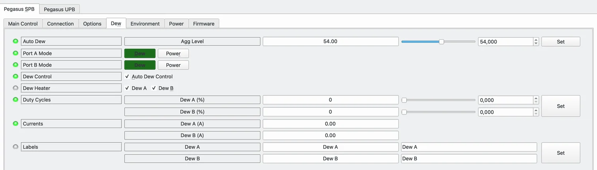
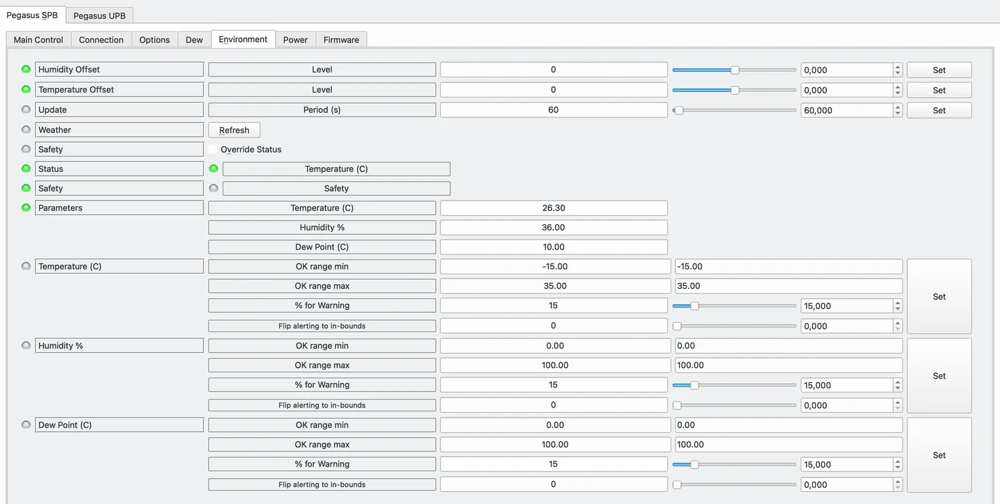
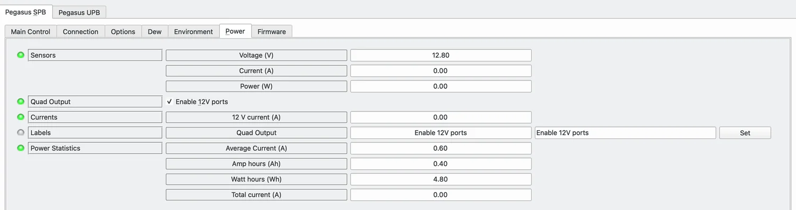
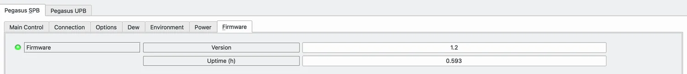

The Pegasus Astro **Saddle Powerbox** is a telescope saddle (Vixen and Losmandy) with a built-in power and USB hub. The INDI driver `indi_pegasus_spb` controls its 12 V outputs, the two dew heater outputs and auto dew, and reads its power and environment sensors. This page describes the driver version 1.3; it was tested with firmware 1.2.

## Features

- Quad 12 V output, switched as one channel
- Two dew heater outputs with duty cycle and current, each usable as a constant 12 V output instead
- Auto dew with adjustable aggressiveness
- Voltage, current and power, and consumption statistics
- Temperature, humidity and dew point, with calibration offsets
- Firmware version and uptime

The USB hub (two USB3 and two USB2 ports) is always on and cannot be switched.

## Connection

Connect the Saddle Powerbox to the PC or StellarMate with the USB cable. It shows up as a serial port named **Espressif USB JTAG/serial debug unit** (for example `/dev/ttyACM0`); select it on the **Connection** tab. The driver identifies the device by its reply to `P#`, which starts with `SPB`.

## Driver Controls

### Dew

- **Auto Dew:** aggressiveness of the automatic dew control, 0 to 100. The device stores it (as 10 to 254).
- **Port A Mode / Port B Mode:** **Dew** for a dew heater with a duty cycle, **Power** for a constant 12 V output. The mode is stored in the device.
- **Dew Control:** switches auto dew on or off. With auto dew on, the device controls both dew outputs, and both channels show as on.
- **Dew Heater:** switches a channel on with its duty cycle, or off. A port in power mode is switched fully on.
- **Duty Cycles:** power of each channel in percent. A duty cycle set while a channel is off is kept and used when the channel is switched on.
- **Currents:** current of each dew output.
- **Labels:** names for the dew outputs.

> [!CAUTION]
> A port in power mode supplies a constant 12 V. Do not connect a dew heater to a port in power mode: it would run at full power without control.

### Environment

- **Humidity Offset:** correction of the humidity sensor, −50 to 50 %.
- **Temperature Offset:** correction of the temperature sensor, −40 to 40 °C.
- **Parameters:** temperature, humidity and dew point.

Both offsets are stored in the device. The temperature is the critical parameter: when it leaves its OK range, the weather status of the driver changes to warning or alert. With the default range of −15 to 35 °C and 15 %, the warning starts at about 27.5 °C. Adjust the ranges to your site; the dew point range starts at 0 °C by default, so negative dew points in winter show as alert.

### Power

- **Sensors:** input voltage, current and power.
- **Quad Output:** switches the four 12 V outputs together.
- **Currents:** current of the 12 V outputs.
- **Labels:** name of the quad output.
- **Power Statistics:** average current, amp hours and watt hours since the device started, and the total current.

After the device has started, its current sensor can report a small negative value. The driver shows it as 0.

### Firmware

Firmware version and uptime of the device.

## Settings stored in the device

The Saddle Powerbox stores the auto dew aggressiveness, both sensor offsets and the mode of both dew ports itself. The driver reads them on connection and does not keep them in the INDI configuration, so changes made in Pegasus Unity are not overwritten. Configurations saved by driver versions up to 1.2 still contain these values, often the defaults (both ports in power mode, aggressiveness 0); they are ignored when the configuration is loaded.

The states of the quad output and the dew channels are kept in the INDI configuration. Ekos loads the configuration on connection and switches the outputs to the saved states.

## Troubleshooting

- **No serial port named Saddle Powerbox:** the device appears as *Espressif USB JTAG/serial debug unit*.
- **A dew channel stays off after switching it on** (driver versions up to 1.2): the duty cycle was 0. Set the duty cycle and switch the channel on again.
- **The quad output shows an alert after switching** (versions up to 1.2): the output was switched; version 1.3 reports it correctly.
