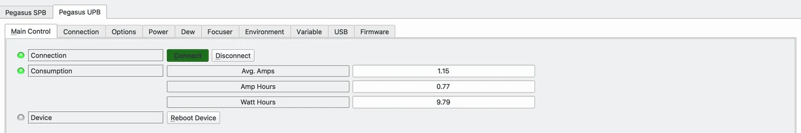
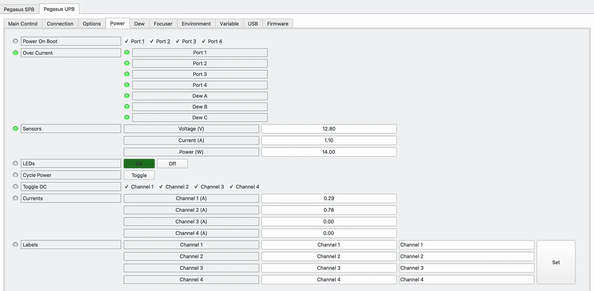
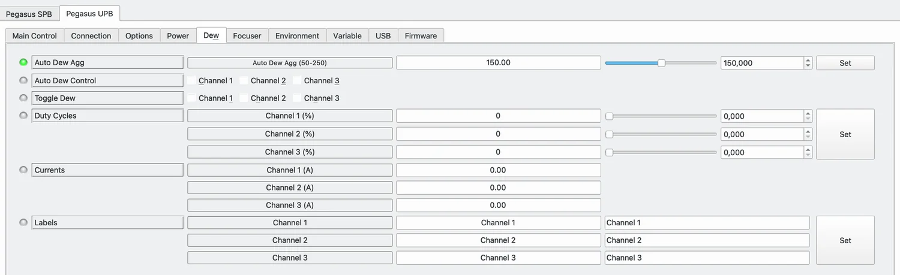
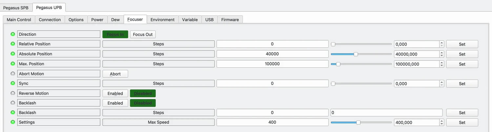
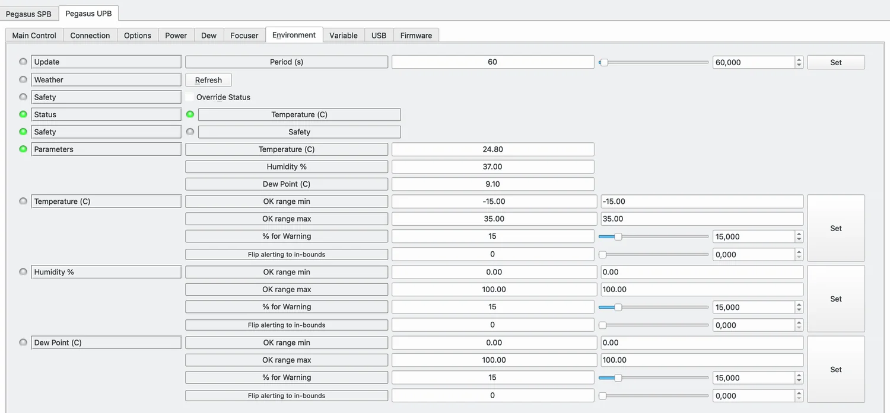
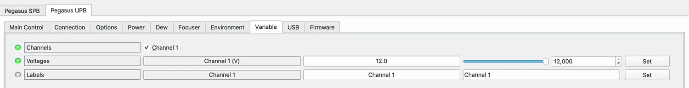
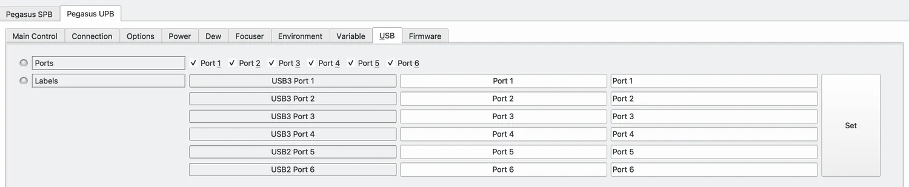
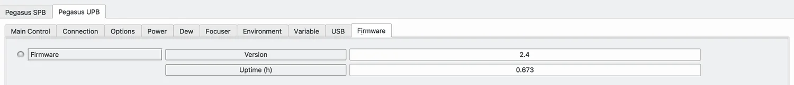

The INDI Pegasus UPB driver (`indi_pegasus_upb`) controls the Pegasus Astro **Ultimate Powerbox v1 and v2**. The Ultimate Powerbox v3 has its own driver, `indi_pegasus_upb3`. This page describes the driver version 1.7 with an Ultimate Powerbox v2; it was tested with firmware 2.4.

## Features

- Four 12 V outputs, switched one by one, with current per port and over current indication
- Outputs switched on when the device boots (**Power On Boot**)
- Three dew heater outputs with duty cycle, current, and auto dew per channel (v2)
- Adjustable output, 3 to 12 V (v2)
- Six USB ports, switched one by one (v2)
- Built-in stepper motor focuser control
- Voltage, current, power and consumption monitoring
- Temperature, humidity and dew point
- LED control and device reboot

Please make sure the power box is updated to the latest firmware before using it with the INDI driver.

## Connection

Connect the UPB to the PC or StellarMate with the USB cable. The operating system assigns a serial port to the device, for example `/dev/ttyUSB0`. The default baud rate is 9600. If the driver cannot connect on the selected port, it searches the other serial ports of the system.

The driver detects the version from the reply to `P#`: `UPB2_OK` is an Ultimate Powerbox v2, anything else is treated as v1.

> [!CAUTION]
> If the PC or StellarMate runs from one of the UPB outputs, switching that output off also switches off the computer that runs INDI. The computer then cannot switch the output on again. Give that output a label such as "StellarMate" and leave it on, also in **Power On Boot**.

## Driver Controls

### Main Control

- **Consumption:** average current, amp hours and watt hours since the device started.
- **Reboot Device:** restarts the UPB controller.

### Power

- **Power On Boot:** the 12 V outputs that the device switches on when it starts. The setting is stored in the device.
- **Over Current:** one light for each 12 V and dew output. The device switches an output off when it detects a short circuit or an over current, and the light turns red.
- **Sensors:** input voltage, total current and power.
- **LEDs:** switches the LED of the UPB on or off.
- **Cycle Power:** switches all four 12 V outputs and the dew outputs **on**. The UPB has no command to switch everything off and on again, so this is not a power cycle.
- **Toggle DC:** switches the four 12 V outputs one by one.
- **Currents:** current of each 12 V output.
- **Labels:** names for the outputs, for example the device that runs from it.

> [!WARNING]
> On UPB v2 boards from revision C on, the stepper motor output sleeps while the LED is off. Keep the LED on if you use the focuser output.

### Dew

- **Auto Dew Agg:** aggressiveness of the automatic dew control, stored in the device.
- **Auto Dew Control:** automatic dew control for each of the three channels.
- **Toggle Dew:** switches a dew channel on with its duty cycle, or off.
- **Duty Cycles:** power of each channel in percent. A duty cycle set while a channel is off is kept and used when the channel is switched on.
- **Currents:** current of each dew channel.

### Focuser

If a stepper motor focuser is connected to the motor output, it can be controlled from this tab:

- **Relative Position** with **Direction**, and **Absolute Position** within **Max. Position**
- **Abort Motion** and **Sync** to set the current position to any value
- **Reverse Motion**
- **Backlash:** enable the compensation and set the steps. When the compensation is enabled again, the steps set before are used again.
- **Settings:** maximum speed of the motor (0 to 900), stored in the device.

### Environment

Temperature, humidity and dew point of the sensor of the UPB, and their ranges. The temperature is the critical parameter: when it leaves its OK range, the weather status of the driver changes to warning or alert.

Each parameter has an OK range (min and max) and a warning zone in percent of that range. With the default temperature range of −15 to 35 °C and 15 %, the warning starts at about 27.5 °C. Adjust the ranges to your site; the dew point range starts at 0 °C by default, so negative dew points in winter show as alert.

### Variable

The adjustable output (v2) always supplies its voltage, 3 to 12 V. It cannot be switched off; the driver shows it as on and refuses to switch it off. The voltage is stored in the device.

### USB

The six USB ports (USB3 ports 1 to 4, USB2 ports 5 and 6) can be switched one by one. The UPB v1 can only switch the whole hub.

### Firmware

Firmware version and uptime of the device.

## Settings stored in the device

The UPB stores **Power On Boot**, the auto dew aggressiveness, the focuser maximum speed and the voltage of the adjustable output itself. The driver reads them on connection and does not keep them in the INDI configuration, so changes made in Pegasus Unity are not overwritten. Configurations saved by driver versions up to 1.6 still contain these values; they are ignored when the configuration is loaded.

The states of the outputs, the dew channels and the USB ports are kept in the INDI configuration. Ekos loads the configuration on connection and switches the outputs to the saved states.

## Troubleshooting

- **All USB ports showed as off after reconnecting** (driver versions up to 1.6): reconnect with version 1.7, which sends the real states after every connection.
- **A dew channel stays off after switching it on** (versions up to 1.6): the duty cycle was 0. Set the duty cycle and switch the channel on again.
- **The focuser backlash is 1 step after enabling it** (versions up to 1.6): set the backlash steps again.
- **An output is off and its Over Current light is red:** remove the short circuit or the device with too high a current, then switch the output on again.
